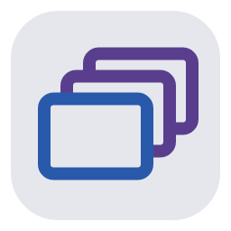
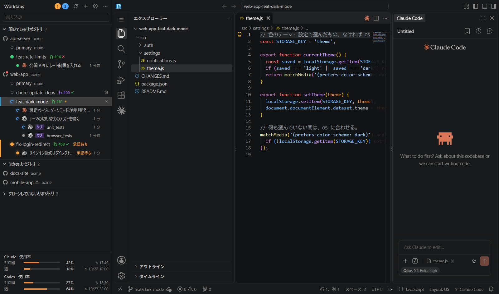

# Worktabs

<picture>
  <source media="(prefers-color-scheme: dark)" srcset="src/assets/icon.png">
  
</picture>

[English](README.md) | **日本語**

Claude Code と Codex の会話をひとつの窓に集め、git worktree ごとにタブで開きます。

> 早期プレビュー（v0.x）です。版が変わると、設定や動きが変わることがあります。

git worktree ごとにブラウザ版 VS Code（code-server）を起動し、左のサイドバーで切り替えるアプリです。各タブでは、選んだエージェントの拡張とそのチャット欄をそのまま使います。Claude Code は既定で入ります。Codex は、対応する拡張をインポートすると使えます。どの会話が作業中か、自分の返事を待っているかは、サイドバーのバッジと OS の通知でわかります。Windows と macOS で動きます。

## 誰のためのものか

**いつもどおりの VS Code を使い続けたい人のためのものです。** ADE（Agentic Development Environment。エージェントと開発するための環境）は次々に出ていますが、その多くは、どこかの企業や誰かが考えた新しいエディタとチャット欄に乗り換えるものです。Worktabs は VS Code を置き換えません。各タブは VS Code（code-server）で、チャット欄は Claude Code 拡張そのものです。Worktabs が足すのは、worktree ごとのタブと、すべての会話を見渡すサイドバーという外枠だけです。

**PC の前にいるときの ADE です。クラウドのセッションと併用してください。** Claude のクラウドのセッション（Claude Code on the web）はクラウドで動くので、PC を立ち上げていなくても使えて便利です。Worktabs は、PC の前にいるときに使うものです。作者も Worktabs を毎日使っていますが、PC の前にいないときはクラウドのセッションを使っています。

## なぜ作ったか

AI エージェントを使うようになって、いくつものリポジトリで、いくつもの会話を同時に進めるのが当たり前になりました。それを 1 か所で見渡したい、というのが出発点です。

**同じリポジトリで会話を並べると、ぶつかります。** 1 つのフォルダで複数の会話を動かすと、ブランチを取り合ったり、互いの変更を踏んだりします。git worktree で作業場所を分ければ、かち合いません。

**Claude Code の VS Code 拡張は、会話ごとに worktree を分けられません**（[anthropics/claude-code#69554](https://github.com/anthropics/claude-code/issues/69554)）。worktree ごとに VS Code を 1 つずつ開けば、拡張が対応していなくても分けられます。ただ、Windows では VS Code の窓をタブにまとめられず（`window.nativeTabs` は macOS だけ）、どの窓の Claude が自分を待っているかは、窓を 1 つずつ見ないとわかりません。macOS では窓をタブにまとめられますが、どの会話が待っているかは、やはり 1 つずつ見ることになります。

**そこで、worktree ごとの VS Code を 1 つの窓のタブにまとめ、会話の状態をサイドバーに集めるアプリを作りました。** VS Code はほぼフル機能のまま使え、Claude Code 拡張のチャット欄も作り直さずにそのまま使うので、拡張に機能が増えれば、そのまま使えます。

既存のツールでは足りませんでした。

- [herdr](https://github.com/herdrdev/herdr) は、エージェントのためのターミナルのマルチプレクサーです。VS Code の中で Claude Code を使う、いまの使い方には合いません。
- [Orca](https://github.com/stablyai/orca) は、worktree ごとにエージェントを並べられ、いい線を行っています。ただ、Claude Code はターミナル（CLI）で動かします。実験的な機能のチャット欄もありますが、VS Code 拡張のチャット欄ほどの機能はありません。
- Claude デスクトップアプリの Code タブは、worktree で会話を分けられます。ただ、VS Code のエディタと拡張は使えません。
- Claude のクラウドのセッション（Claude Code on the web）なら、会話ごとに環境が分かれます。ただ、会話はクラウドの Linux の環境で動きます。実機が要る直しや確かめはできず、このアプリのようなクライアントアプリを作るときは、ここがネックになります。それでも、Worktabs と併用すると便利です（[誰のためのものか](#誰のためのものか)）。
- VS Code の Agents window でも Claude を使えますが、VS Code が用意するハーネスで、Claude Code 拡張とは別物です（既定では Copilot の契約で動きます）。
- 同じ種類のツールには、macOS 専用のものも多くあります（Conductor、Superset など）。

既存のツールとの細かい比較と設計の判断は [docs/research.md](docs/research.md)（英語）にあります。

### 割り切り

- 独自のチャット欄やエディタは作りません。code-server と Claude Code 拡張をそのまま使います。
- 各タブは code-server で、デスクトップ版の VS Code ではありません。設定と拡張はデスクトップ版とは別です。Claude は既定で Open VSX から入れます。対応していて利用が許されている拡張は、デスクトップ版の VS Code や VSIX からインポートすることもできます（[拡張の管理](docs/ja/extensions.md)）。
- worktree は、`git worktree` や Orca など、ほかの方法で作ったものもそのまま開けます。
- メモリは、タブ 1 つで約 0.8 GB 使います。その代わりに VS Code のフル機能が使えます。
- Windows と macOS で動きます。Claude Code は既定で入ります。Codex は、対応していて利用が許されている拡張をインポートすると使えます。WSL のタブは Windows だけです。

## できること

- サイドバーに、リポジトリ → worktree → 会話のツリーを出します。worktree をクリックすると、その VS Code をタブとして開きます。
- 会話ごとに、作業中・承認待ち・完了をバッジで出し、その状態になってからの時間（「12 分」「5 分前」）も出します。裏のタブの会話が承認待ちか完了になると、OS の通知が出ます。
- サイドバーから worktree を追加・削除できます。`.worktreeinclude` に書いた `.env` などもコピーします。
- GitHub の issue ややることから worktree を作ると、選んだエージェントがブランチ名を考え、新しい会話の入力欄に指示を下書きとして入れておきます。PR の番号からは、その PR のブランチを取り出したレビュー用の worktree を作れます。指示を Worktabs が自動で送ることはありません。
- worktree の行に、そのブランチの PR の状態（ドラフト・オープン・マージ済み・クローズ）と CI の結果を出します。マージ後の main の CI と、リリース（タグ）の CI も出します。自分の PR が Approve 済みでまだマージしていないリポジトリは、アイコンの右上に赤い点が出ます（その worktree が手元になくても）。
- リポジトリの行に、GitHub で private・internal のリポジトリかをアイコンで出します。
- 自分と、自分が入っている org の GitHub のリポジトリのうち、まだクローンしていないものを owner ごとに出し、ボタン 1 つでクローンできます（ghq があれば ghq で、なければ選んだフォルダに git で。Windows では Windows と WSL のどちらにも）。
- 使っていないタブを休止して、メモリを空けます。次の起動では、前回開いていたタブを戻します。
- Claude と Codex のサブスクリプションの使用量を、取得できればサイドバーの下端に出します。
- WSL の中のリポジトリも、同じようにタブで開けます（Windows のみ）。

画面は英語か日本語で、システムの言語に合わせます（設定の `locale`）。

Codex を使うには、「設定 > 拡張」でその拡張をインポートし、「設定 > 一般」で有効にして、チャット欄からサインインします。両方のエージェントを同時に有効にでき、新しいタブは既定のエージェントで開き、既存の会話はそれぞれのエージェントのままです。設定のしかたと、実際の拡張での確認がまだの環境は、[エージェントの設定](docs/ja/config.md)と [Codex の検証の表](docs/ja/codex-verification.md)にあります。

ウィンドウの地図と、それぞれの部分でできることは [docs/ja/features.md](docs/ja/features.md) にあります。

## 必要なもの

- Windows 11、または macOS（確認したのは macOS 26.5、Apple Silicon）
- git
- （任意）[ghq](https://github.com/x-motemen/ghq)。サイドバーのリポジトリ一覧を `ghq list` から作ります
- （任意）WSL2。WSL の中のリポジトリを開くときに使います
- （ソースからビルドするときだけ）Node.js と npm

## インストール

[Releases](https://github.com/worktabs/worktabs/releases) から、OS に合ったものを取ります。

- `Worktabs-<版>-setup.exe`: Windows のインストーラー。ユーザー単位で入れるので、管理者権限は要りません。
- `Worktabs-<版>-win.zip`: Windows 版。好きなフォルダに展開して、`Worktabs.exe` を起動します。インストールは要りません。
- `Worktabs-<版>-arm64-mac.zip`: macOS 版（Apple Silicon）。展開した `Worktabs.app` を「アプリケーション」に移して起動します。

Windows 版は署名していません。macOS 版はアドホック署名で、公証（notarization）は受けていません。

- Windows: 初回の起動で SmartScreen の警告が出ます。「詳細情報」→「実行」で進めます。
- macOS: 初回の起動の前に `xattr -dr com.apple.quarantine /Applications/Worktabs.app` を実行します。

code-server と拡張は、初回の起動時に自動で取得します（約 300 MB）。ダウンロードしたものの確かめ方（`SHA256SUMS.txt`）、新しい版への更新、ソースからのビルドは [docs/ja/install.md](docs/ja/install.md) にあります。

## 使い方

1. Worktabs を起動します。サイドバーに `ghq list` のリポジトリが並びます。ほかのリポジトリは、上端の「＋」の「リポジトリを追加…」で足します。
2. worktree をクリックすると、その VS Code がタブで開きます。中の Claude Code のチャット欄は、いつもどおり使います。
3. サイドバーのバッジを見ます。会話の行か通知をクリックすると、そのタブのその会話に移ります。
4. worktree は、リポジトリの行の「＋」で追加します。消すときは、worktree の行の右クリックか、行のゴミ箱のボタンを使います。

詳しくは [docs/ja/usage.md](docs/ja/usage.md) と [docs/ja/worktrees.md](docs/ja/worktrees.md) にあります。

## 設定

設定ファイルは、Windows では `%APPDATA%\Worktabs\config.json`、macOS では `~/Library/Application Support/Worktabs/config.json` です。サイドバーの「…」の「設定ファイルを開く」から開けます。書いていない項目は既定値になります。書き方の例は [config.example.json](config.example.json) です。

| キー | 意味 |
|---|---|
| `repoSources` | リポジトリ一覧の取得元。`"ghq"`、`"wsl"`（WSL のディストリごとの `ghq list`）、`"wsl:<ディストリ名>"`。既定は `["ghq", "wsl"]` |
| `repos` | 手で追加したリポジトリ |
| `codeServerDir` | 取得せず、既存の code-server を使うときのフォルダ |
| `codeServerVersion` | 取得する code-server の版（既定は動作を確認した版） |
| `updateCheck` | 起動時に code-server と拡張の新しい版を確認する（既定 `true`） |
| `extensions` | Open VSX から入れる拡張（既定は Claude Code）。表示言語の言語パックは自動で加える |
| `locale` | アプリと VS Code の表示言語。空（既定）なら OS に従う |
| `permissionMode` | 新しい会話の初期権限モード（`auto`・`manual`・`acceptEdits`・`plan`）。既定は `auto` |
| `idleSuspendMinutes` | 使っていないタブを、この分数で休止する（`0` で無効） |

すべてのキー、データフォルダ、ログは [docs/ja/config.md](docs/ja/config.md) にあります。

## 仕組み

- **code-server**: worktree ごとに 1 プロセス起動し、`127.0.0.1` だけで待ち受けます。`user-data-dir` は worktree ごとに分け、拡張は共有します。VS Code の設定は、同じリポジトリの worktree のタブで共有します。
- **Claude Code の hooks**: 拡張は、小さなラッパー（`claudeCode.claudeProcessWrapper`）を通して `claude` を起動します。ラッパーが、http hook を書いた `--settings` を足します。hooks が効くのはアプリが起動した会話だけで、`~/.claude/settings.json` もリポジトリの `.claude/` も変えません。ラッパーは、claude の出力の使用量もアプリに渡します。
- **補助拡張**: 各 code-server に入れる小さな拡張です。サイドバーでクリックした会話を前に出し、テーマの色をサイドバーに渡し、VS Code Web にないデスクトップ版のコマンド（エクスプローラーや Finder で表示するなど）を足します。

### セキュリティの前提

- code-server、hooks の受信口、補助拡張は、どれも `127.0.0.1` だけで、ランダムなポートで待ち受けます。
- code-server は `--auth password` で、起動のたびにランダムな値を使います。アプリが、それに合うクッキーをタブに直接書きます。平文のパスワードはないので、ログイン画面から入ることはできません。
- hooks の受信口は、起動ごとに作るトークンで検証します。
- 同じマシンで同じユーザーとして動くほかのプログラムは信頼します。それからは守りません。

詳しくは [docs/ja/architecture.md](docs/ja/architecture.md) にあります。脆弱性の知らせ方は [セキュリティポリシー](.github/SECURITY.md)（英語）にあります。

## 取得する外部のソフトウェア

初回の起動時に、次のものを取得して動かします。

- [code-server](https://github.com/coder/code-server)（GitHub のリリースから）
- [Claude Code 拡張](https://open-vsx.org/extension/Anthropic/claude-code)と、VS Code を英語以外で表示するときはその言語パック（[Open VSX](https://open-vsx.org/) から）

Claude Code を使うには、自分の Claude のアカウントが要り、Anthropic の規約に従います。Codex の拡張は Worktabs が取得するのではなく、自分でインポートします（[拡張の管理](docs/ja/extensions.md)）。Codex を使うときは OpenAI の規約に従います。

Worktabs は独立したプロジェクトで、Anthropic や OpenAI とは関係がなく、両社が認めたり支援したりしているものではありません。Claude と Claude Code は Anthropic の商標です。OpenAI と Codex は OpenAI の商標です。

## ドキュメント

[docs/research.md](docs/research.md) のほかは、どのページにも [docs/ja/](docs/ja/) に日本語版があります。

| ページ | 中身 |
|---|---|
| [docs/ja/features.md](docs/ja/features.md) | ウィンドウの地図と、それぞれの部分でできること |
| [docs/ja/install.md](docs/ja/install.md) | インストール、新しい版への更新、ソースからのビルド |
| [docs/ja/usage.md](docs/ja/usage.md) | 使い方（サイドバー、バッジと通知、タブの操作、使用量、code-server の更新） |
| [docs/ja/worktrees.md](docs/ja/worktrees.md) | worktree の追加と削除 |
| [docs/ja/wsl.md](docs/ja/wsl.md) | WSL のリポジトリ |
| [docs/ja/config.md](docs/ja/config.md) | 設定ファイルとデータフォルダ |
| [docs/ja/limitations.md](docs/ja/limitations.md) | 既知の制限 |
| [docs/ja/architecture.md](docs/ja/architecture.md) | 仕組み |
| [docs/ja/development.md](docs/ja/development.md) | 開発（そのまま起動する、テスト、開発用チェック） |
| [docs/ja/translations.md](docs/ja/translations.md) | 日本語ドキュメントと UI 文字列の更新 |
| [docs/ja/releasing.md](docs/ja/releasing.md) | リリース（版の上げ方、CHANGELOG、GitHub Releases） |
| [docs/research.md](docs/research.md) | 設計の根拠になった調査と検証の要約（英語） |

## コントリビューション

ブランチ・コミット・PR の決まりは [CONTRIBUTING.md](.github/CONTRIBUTING.md)（英語）に、互いの接し方は[行動規範](.github/CODE_OF_CONDUCT.md)（英語。[公式の日本語訳](https://www.contributor-covenant.org/ja/version/2/1/code_of_conduct/)）にあります。予定している作業は [issue](https://github.com/worktabs/worktabs/issues) にあります。issue と PR は、日本語でも英語でも構いません。

## ライセンス

[MIT](LICENSE)。インストーラーと zip に入る第三者のソフトウェアと、Worktabs が実行時に取得するものは [THIRD_PARTY_NOTICES.md](THIRD_PARTY_NOTICES.md)（英語）にまとめています。

Claude Code 拡張は Worktabs に同梱していません。Open VSX から取得し、Anthropic のライセンスに従います。使うには利用者自身の Claude のアカウントが要り、Anthropic の利用規約に従う必要があります。
