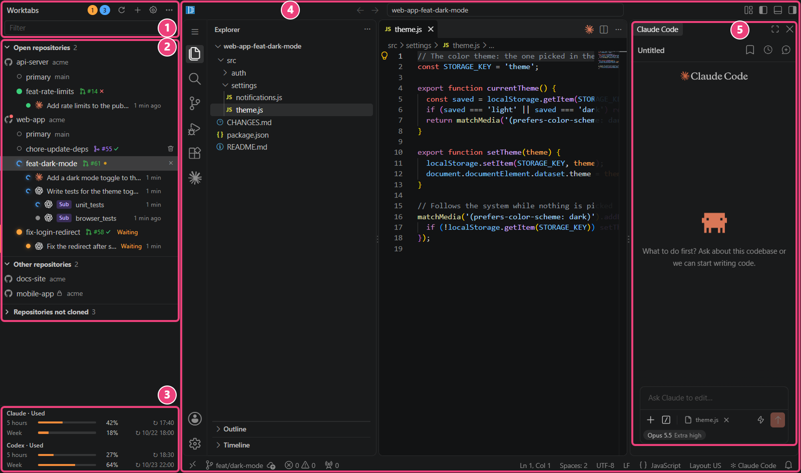
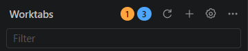
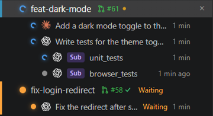
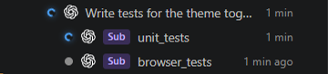
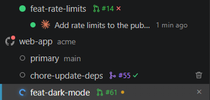
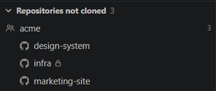
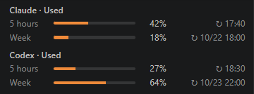
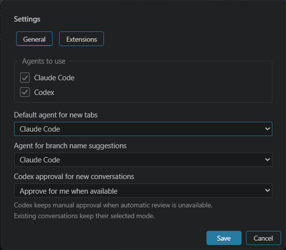

# Features

**English** | [日本語](ja/features.md)

A map of the Worktabs window, and what you can do in each part of it. The screenshot is the one in the [README](../README.md), with example data. How each part works in detail is in [usage.md](usage.md).

Some of what this page lists shows only when you hover over a row, in a dialog, or in another state, so it is not in the screenshot. What is outside the five parts, such as the settings dialog, is under "[Not in the screenshot](#not-in-the-screenshot)".

| | Part | What it is |
| --- | --- | --- |
| 1 | [Top of the sidebar](#1-top-of-the-sidebar) | The counts of conversations that need you, and the buttons for the whole app |
| 2 | [Repository tree](#2-repository-tree) | Repositories → worktrees → Claude Code and Codex conversations, with their states, PRs, and CI |
| 3 | [Subscription usage](#3-subscription-usage) | How much of your Claude and Codex limits you have used |
| 4 | [VS Code of the selected worktree](#4-vs-code-of-the-selected-worktree) | VS Code itself, in a tab, for the worktree you picked |
| 5 | [Agent chat panel](#5-agent-chat-panel) | The Claude Code or Codex extension, in the right sidebar of that VS Code |

## 1. Top of the sidebar

- See how many conversations wait for you (orange) and how many are working (blue), across all tabs and both agents. Codex's requests for approval, permission, or your input count as waiting.
- Press a count to jump to the next conversation in that state.
- Type in the filter field to narrow the tree to a repository, worktree, branch, issue, or conversation title.
- Reload the repository list (the circular arrow), add a repository or open a folder ("＋"), open the settings (the gear), and check for updates or open the settings file ("…").
- Update code-server and the extensions from the card that appears here when a new version is out. The update waits until no agent is working or waiting for you and your edits are saved. "Extensions and updates" on the card opens the extension settings ([below](#settings-and-extensions)).

More: [usage.md, "Top bar"](usage.md#top-bar), ["Filter"](usage.md#filter), and ["Updating code-server and extensions"](usage.md#updating-code-server-and-extensions).

## 2. Repository tree

"Open repositories" lists the repositories with open tabs. "Other repositories" lists the rest, from `ghq list` and the ones you added. "Repositories not cloned" lists your GitHub repositories that are not on this computer yet ([below](#repositories-not-cloned)).

- Click a worktree to open it as a tab, or to switch to its tab if it is open.
- Add a worktree with "＋" on a repository row, from a GitHub issue or PR, or from a sentence that says what to do. Remove one with the trash button on its row ([worktrees.md](worktrees.md)).
- See each Claude Code and Codex conversation of an open worktree on a row of its own. Click it to bring that conversation to the front. Archive a finished one to take its row off the list.
- Close all the tabs of a repository at once with the button that shows when you hover over its row.
- Hover over a repository's icon for buttons to its pages on GitHub (the repository, Issues, Pull requests, and Actions).
- Tell private and internal GitHub repositories by the lock or building next to their names (mobile-app here).
- Right-click a row for more, such as restarting or suspending the tab, opening the folder in File Explorer, and copying its path.

More: [usage.md, "Sidebar"](usage.md#sidebar).

### Conversation states

- See whether the agent is working, waiting for you, or done in each conversation, and for how long.
- Tell which agent a conversation belongs to by its mark: the Claude starburst for Claude Code, the OpenAI knot for Codex.
- Tell at a glance where to look: a worktree row shows the most urgent state among its conversations.
- Get an OS notification when a conversation in another tab waits for you, finishes, or fails. Click it to jump to that conversation.

More: [usage.md, "Conversations"](usage.md#conversations) and ["Badges and notifications"](usage.md#badges-and-notifications).

### Codex subagents

- See the subagents a Codex conversation hands work to, each on a row one step in under that conversation, with a "Sub" label and its nickname, role, or agent path.
- Click a subagent's row to open its own thread and see what it did.
- Follow each subagent's working and waiting states on its row. When the subagents finish, the conversation that started them reports the result, so you get one notification rather than one for each.

More: [usage.md, "Conversations"](usage.md#conversations).

### PRs and CI

For repositories on GitHub, with gh signed in:

- See the PR of each worktree's branch and its CI result on the row. Hover to see each check, and press to open the PR.
- Open the page for creating a PR from the branch icon that shows when you hover over a worktree with no PR.
- See the issue a worktree was made from, such as `#20`, next to its branch. Press it to open the issue.
- Remove the worktree of a merged PR right away: its trash button shows without hovering.
- Notice your own PRs that are approved and wait to be merged: a red dot shows on the repository's icon (web-app here).

More: [usage.md, "PRs and CI"](usage.md#prs-and-ci).

### Repositories not cloned

- See the repositories of your GitHub account and your organizations that are not cloned yet, grouped by owner.
- Clone one with the button on its row: with ghq if it is installed, else with git into a folder you pick. On Windows, you can clone into Windows or a WSL distribution.
- Hide an owner with many repositories from the right-click menu of its row.

More: [usage.md, "Repositories not cloned"](usage.md#repositories-not-cloned).

## 3. Subscription usage

- See how much of Claude's 5-hour limit and weekly limit you have used, and when each resets.
- With Codex enabled, see its limits under Claude's, in a section of its own. Codex reports its own windows, such as "5 hours" and "Week".
- Hover over a row for the reset date and time and when the value was received.

Worktabs reads both at start and every 5 minutes. It sends no message to a model for this.

More: [usage.md, "Claude usage"](usage.md#claude-usage) and ["Codex usage"](usage.md#codex-usage).

## 4. VS Code of the selected worktree

The worktree you pick in the tree opens in a tab with VS Code itself (code-server runs VS Code in the browser). It is not an editor made to look like VS Code, so you work in it as you do in VS Code.

- Edit, search, and use the terminal, git, and extensions as in VS Code. The agent chat panel (5) is part of it too.
- Switch between worktrees from the tree, or with Ctrl+Alt+PageUp and PageDown. Each worktree keeps its own VS Code, with its open files and layout.
- Change a setting such as the theme or the font once: the tabs of one repository's worktrees share it.
- Suspend the tabs you are not using to free memory, by hand or after a while (a setting). A suspended tab comes back when you select it, and the tabs open at exit come back on the next start.

It is code-server rather than your desktop VS Code: its settings and extensions are kept apart from the desktop app's. Claude Code comes from Open VSX, and you import Codex from desktop VS Code or a VSIX file ([README, "Trade-offs"](../README.md#trade-offs)).

More: [usage.md, "Tabs"](usage.md#tabs).

## 5. Agent chat panel

The chat panel is the agent's own extension, Claude Code or Codex, in the right sidebar of the VS Code (4), not a rebuild of it. New features of the extension work as soon as they come out. The screenshot shows Claude Code.

- Work with the agent in the worktree of the tab. Each tab's agent works in its own worktree, so several can work at once without touching each other's files.
- Start right away in a tab opened for the first time: the app puts the chat panel here, as wide as in the repository's primary tab. In a worktree other than primary, the agent's introductory guidance is skipped.
- With both agents enabled, new tabs open the default agent's panel. Each conversation keeps its own agent.
- Follow the conversations in the tree (2): each one started here gets a row there, with its state.
- Find the instruction already in the input box when you made the worktree from an issue or a sentence of what to do. It is a draft: Worktabs never sends it for you.
- Let Codex review its own requests for approval in a new conversation ("Approve for me"), when the extension allows it. A setting makes it ask you instead.

More: [usage.md, "Claude panel"](usage.md#claude-panel) and ["Codex approvals"](usage.md#codex-approvals).

## Not in the screenshot

### Settings and extensions

The gear at the top of the sidebar opens the settings dialog.

- "General": choose the agents to use (Claude Code, Codex, or both), the default agent for new tabs, the agent that suggests branch names, and how new Codex conversations handle approval.
- "Extensions": see each extension's source and version, import extensions from desktop VS Code or VSIX files, check for updates and apply them, and go back to the previous version.

More: [config.md](config.md) and [extensions.md](extensions.md).

### Codex

To use Codex, import its extension in "Extensions", enable it in "General", and sign in from its chat panel. It then works as Claude Code does in every part above: its conversations and subagents in the tree, the counts and notifications, its usage, and its chat panel. Some environments are still waiting for checks with the real extension ([codex-verification.md](codex-verification.md)).

### Other

- Open repositories inside WSL as tabs in the same way, on Windows ([wsl.md](wsl.md)).
- Use the UI in English or Japanese. It follows the system's language ([config.md](config.md)).
