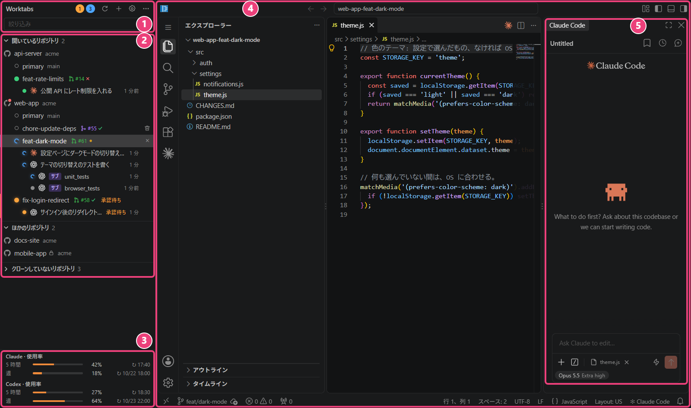
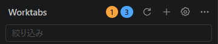
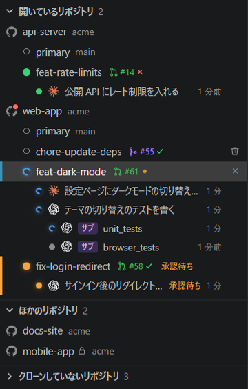
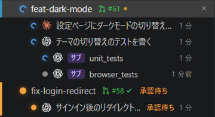
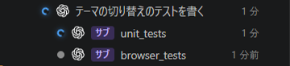
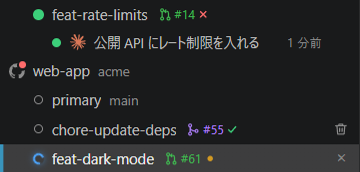
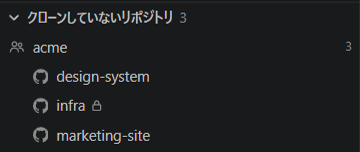
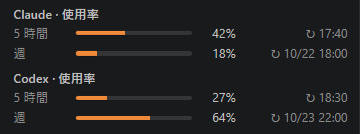
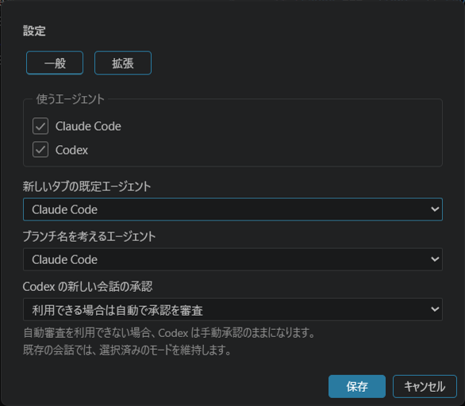

# 機能の紹介

[English](../features.md) | **日本語**

Worktabs のウィンドウの地図と、それぞれの部分でできることです。スクリーンショットは [README](../../README.ja.md) のもので、見本のデータです。それぞれの部分の詳しい動きは [usage.md](usage.md) にあります。

このページに書いたことのうち、行にマウスを乗せたときやダイアログ、ほかの状態でだけ出るものは、スクリーンショットにはありません。設定のダイアログのように、5 つの部分の外にあるものは「[スクリーンショットにないもの](#スクリーンショットにないもの)」にあります。

| | 部分 | 何があるか |
| --- | --- | --- |
| 1 | [サイドバーの上端](#1-サイドバーの上端) | 承認待ちと作業中の会話の数と、アプリ全体のボタン |
| 2 | [リポジトリのツリー](#2-リポジトリのツリー) | リポジトリ → worktree → Claude Code と Codex の会話。その状態、PR、CI |
| 3 | [サブスクリプションの使用量](#3-サブスクリプションの使用量) | Claude と Codex の枠をどれだけ使ったか |
| 4 | [選んだ worktree の VS Code](#4-選んだ-worktree-の-vs-code) | 選んだ worktree をタブで開く、VS Code そのもの |
| 5 | [エージェントのチャット欄](#5-エージェントのチャット欄) | その VS Code の右のサイドバーにある Claude Code 拡張か Codex 拡張 |

## 1. サイドバーの上端

- すべてのタブと両方のエージェントを通して、承認待ちの会話（オレンジ）と作業中の会話（青）がいくつあるかがわかります。Codex の承認、権限、入力の求めも承認待ちに数えます。
- 数を押すと、その状態の次の会話に移ります。
- 絞り込みの欄に入力すると、リポジトリ、worktree、ブランチ、issue、会話の題名でツリーを絞り込めます。
- リポジトリの一覧を読み直せます（丸い矢印）。リポジトリの追加とフォルダを開くことは「＋」から、設定を開くことは歯車から、更新の確認と設定ファイルを開くことは「…」からできます。
- code-server と拡張の新しい版が出ると、ここにカードが出て、そこから更新できます。更新は、作業中や返事待ちのエージェントがなくなり、編集が保存されるまで待ちます。カードの「拡張と更新」で、拡張の設定を開きます（[下](#設定と拡張)）。

詳しくは [usage.md の「上端」](usage.md#上端)と[「絞り込み」](usage.md#絞り込み)、[「code-server と拡張の更新」](usage.md#code-server-と拡張の更新)。

## 2. リポジトリのツリー

「開いているリポジトリ」には、タブを開いているリポジトリが並びます。「ほかのリポジトリ」には、残りのリポジトリ（`ghq list` と、手で追加したもの）が並びます。「クローンしていないリポジトリ」には、自分の GitHub のリポジトリのうち、まだこのコンピューターにないものが並びます（[下](#クローンしていないリポジトリ)）。

- worktree をクリックするとタブで開きます。開いていれば、そのタブに切り替えます。
- worktree は、リポジトリの行の「＋」から、GitHub の issue や PR、やることを書いた文から追加できます。worktree の行のごみ箱ボタンで削除します（[worktrees.md](worktrees.md)）。
- 開いている worktree の Claude Code と Codex の会話は、1 つずつ行になります。クリックすると、その会話を前に出します。終わった会話はアーカイブして、行を一覧から外せます。
- リポジトリのタブは、行にマウスを乗せると出るボタンで、まとめて閉じられます。
- リポジトリのアイコンにマウスを乗せると、GitHub のページ（リポジトリ、Issues、Pull requests、Actions）のボタンが出ます。
- private と internal の GitHub のリポジトリは、名前の横の錠前とビルのアイコンでわかります（ここでは mobile-app）。
- 行を右クリックすると、タブの再起動や休止、エクスプローラーで開く、パスのコピーなどができます。

詳しくは [usage.md の「サイドバー」](usage.md#サイドバー)。

### 会話の状態

- 会話ごとに、エージェントが作業中か、返事を待っているか、完了したかと、その状態がどれだけ続いているかがわかります。
- どのエージェントの会話かは、マークでわかります。Claude Code は Claude の星形、Codex は OpenAI の結び目のマークです。
- どこを見ればよいかが、ひと目でわかります。worktree の行には、その会話のうち最も緊急な状態が出ます。
- ほかのタブの会話が返事を待つか、完了するか、エラーになると、OS の通知が出ます。クリックすると、その会話に移ります。

詳しくは [usage.md の「会話」](usage.md#会話)と[「バッジと通知」](usage.md#バッジと通知)。

### Codex のサブエージェント

- Codex の会話が仕事を任せたサブエージェントが、その会話の 1 段下に 1 つずつ行になります。行には「サブ」の札と、ニックネーム、役割、エージェントのパスのどれかが出ます。
- サブエージェントの行をクリックすると、そのサブエージェント自身のスレッドを開き、何をしたかを見られます。
- サブエージェントの作業中と返事待ちは、それぞれの行に出ます。サブエージェントが終わると、始めた側の会話が結果を伝えるので、通知はサブエージェントごとではなく 1 回です。

詳しくは [usage.md の「会話」](usage.md#会話)。

### PR と CI

GitHub のリポジトリで、gh にサインインしていれば:

- worktree の行に、そのブランチの PR と CI の結果が出ます。マウスを乗せると各チェックが出て、押すと PR を開きます。
- PR のない worktree の行にマウスを乗せると出るブランチのアイコンで、PR を作るページを開けます。
- issue から作った worktree には、ブランチの横に `#20` のように issue が出ます。押すと issue を開きます。
- マージした PR の worktree は、すぐに削除できます。その行のごみ箱ボタンが、マウスを乗せなくても出ます。
- 自分の PR で、Approve 済みでマージを待っているものに気づけます。リポジトリのアイコンに赤い点が出ます（ここでは web-app）。

詳しくは [usage.md の「PR と CI」](usage.md#pr-と-ci)。

### クローンしていないリポジトリ

- 自分の GitHub アカウントと org のリポジトリのうち、まだクローンしていないものが、owner ごとに並びます。
- 行のボタンでクローンします。ghq が入っていれば ghq で、なければ選んだフォルダに git でクローンします。Windows では、Windows か WSL のディストリかを選べます。
- リポジトリの多い owner は、その行の右クリックメニューで出さないようにできます。

詳しくは [usage.md の「クローンしていないリポジトリ」](usage.md#クローンしていないリポジトリ)。

## 3. サブスクリプションの使用量

- Claude の 5 時間の枠と週の枠をどれだけ使ったかと、それぞれがリセットされる時刻がわかります。
- Codex を有効にすると、Claude の下に、Codex の枠が別の節で出ます。Codex は「5 時間」や「週」のように、自分の枠を知らせてきます。
- 行にマウスを乗せると、リセットの日時と、値を受け取った時刻が出ます。

Worktabs は、起動時と 5 分ごとに、両方を読み直します。そのためにモデルへメッセージを送ることはありません。

詳しくは [usage.md の「Claude の使用量」](usage.md#claude-の使用量)と[「Codex の使用量」](usage.md#codex-の使用量)。

## 4. 選んだ worktree の VS Code

ツリーで選んだ worktree が、VS Code そのものを持つタブで開きます（code-server は、VS Code をブラウザで動かすものです）。VS Code に似せたエディタではないので、VS Code と同じように作業できます。

- 編集、検索、ターミナル、git、拡張は、VS Code と同じように使えます。エージェントのチャット欄（5）も、この VS Code の一部です。
- worktree は、ツリーか、Ctrl+Alt+PageUp と PageDown で切り替えます。worktree ごとに自分の VS Code があり、開いているファイルやレイアウトもそれぞれに残ります。
- テーマやフォントなどの設定は、1 度変えれば済みます。同じリポジトリの worktree のタブは、設定を共有します。
- 使っていないタブは、休止してメモリを空けられます。手で休止するか、しばらく使わないと休止します（設定）。休止したタブは、選ぶと戻ります。終了時に開いていたタブは、次の起動で戻ります。

デスクトップの VS Code ではなく code-server なので、設定と拡張はデスクトップのものとは別になります。Claude Code は Open VSX から入れ、Codex はデスクトップの VS Code か VSIX ファイルからインポートします（[README の「割り切り」](../../README.ja.md#割り切り)）。

詳しくは [usage.md の「タブ」](usage.md#タブ)。

## 5. エージェントのチャット欄

チャット欄は、作り直したものではなく、エージェントの拡張そのもの（Claude Code か Codex）で、VS Code（4）の右のサイドバーにあります。拡張の新しい機能も、出てすぐに使えます。スクリーンショットに写っているのは Claude Code です。

- タブの worktree でエージェントと作業します。タブごとのエージェントは、それぞれの worktree で作業するので、互いのファイルに触れずに、いくつも同時に作業できます。
- 初めて開いたタブでも、すぐに始められます。アプリがここにチャット欄を出し、幅はそのリポジトリの primary のタブに合わせます。primary 以外の worktree では、エージェントの最初の案内を飛ばします。
- 両方のエージェントを有効にすると、新しいタブには既定のエージェントのチャット欄が出ます。会話はそれぞれ自分のエージェントのままです。
- 会話の様子は、ツリー（2）で追えます。ここで始めた会話は、ツリーに行ができ、状態が出ます。
- issue ややることを書いた文から worktree を作ったときは、入力欄に指示が入っています。下書きなので、Worktabs が代わりに送ることはありません。
- 新しい Codex の会話では、拡張が許せば、承認の求めを Codex 自身に審査させます（Approve for me）。設定で、毎回たずねるようにもできます。

詳しくは [usage.md の「Claude のパネル」](usage.md#claude-のパネル)と[「Codex の承認」](usage.md#codex-の承認)。

## スクリーンショットにないもの

### 設定と拡張

サイドバーの上端の歯車で、設定のダイアログを開きます。

- 「一般」: 使うエージェント（Claude Code、Codex、その両方）、新しいタブの既定のエージェント、ブランチ名を考えるエージェント、新しい Codex の会話の承認の扱いを選びます。
- 「拡張」: 拡張ごとの入手元と版を見て、デスクトップの VS Code か VSIX ファイルから拡張をインポートし、更新を確認して適用し、前の版に戻せます。

詳しくは [config.md](config.md) と [extensions.md](extensions.md)。

### Codex

Codex を使うには、「拡張」でその拡張をインポートし、「一般」で有効にして、チャット欄からサインインします。そのあとは、上のどの部分でも Claude Code と同じように動きます。ツリーの会話とサブエージェント、数と通知、使用量、チャット欄です。実際の拡張での確認がまだの環境もあります（[codex-verification.md](codex-verification.md)）。

### そのほか

- Windows では、WSL の中のリポジトリも同じようにタブで開けます（[wsl.md](wsl.md)）。
- 画面は英語か日本語で使えます。システムの言語に合わせます（[config.md](config.md)）。
